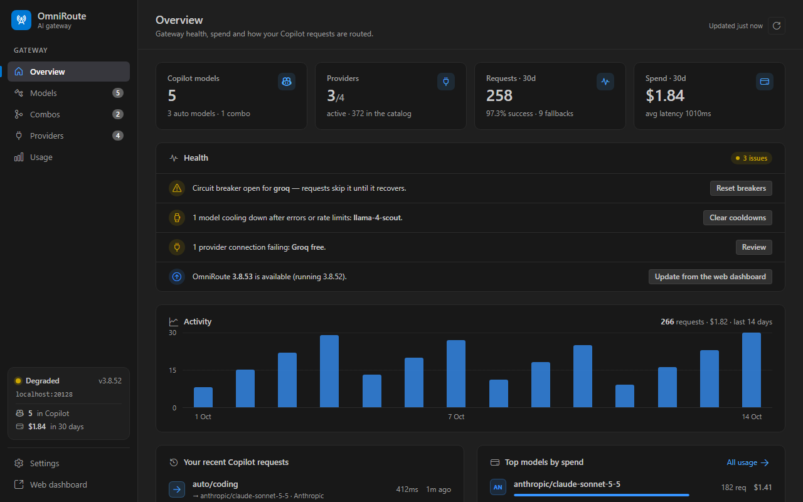
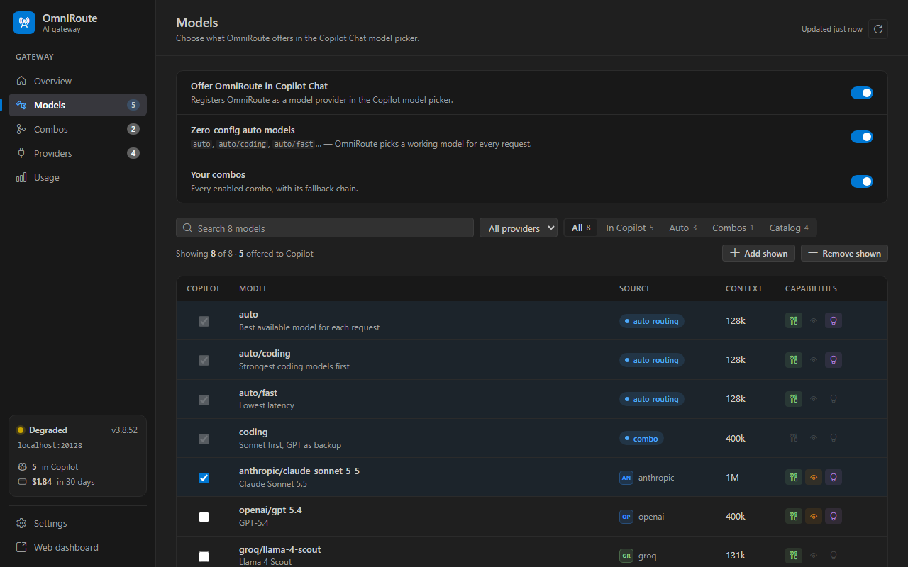
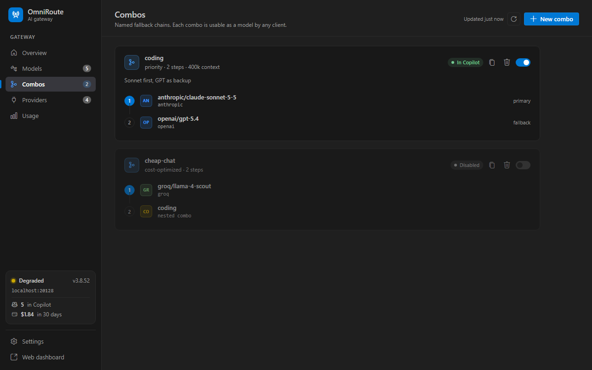

# Gateway Control for OmniRoute

A control panel for the [OmniRoute](https://github.com/diegosouzapw/OmniRoute) AI gateway, inside VS Code. OmniRoute puts hundreds of AI providers behind one OpenAI-compatible endpoint and falls back automatically when a quota runs out or a provider fails. This extension gives you a dashboard to **run, watch and manage** that gateway without leaving the editor — provider quota and health, combos, spend, server control — and also registers its models in **Copilot Chat** and its **MCP tools** in agent mode.

> **Not affiliated with the OmniRoute project.** OmniRoute's author publishes an official extension, [OmniRoute for GitHub Copilot Chat](https://marketplace.visualstudio.com/items?itemName=diegosouzapw.omnicopilot), which focuses on getting OmniRoute's models into the Copilot model picker and ships a UI in 42 languages. If that is all you need, use it. This extension exists for the management side: quota bars, combo editing, provider health, analytics and gateway lifecycle. The two can be installed together.



## Features

- **OmniRoute models in Copilot Chat.** The model picker gets:
  - OmniRoute's zero-config **auto models**: `auto`, `auto/coding`, `auto/fast`, `auto/cheap`, and so on.
  - Every enabled **combo**.
  - Any catalog models you pick.

  Streaming, tool calling (agent mode), image input and reasoning all work.
- **See how each request was routed.** The status bar shows which provider and model answered your last Copilot request, with latency, tokens, cost and fallbacks. Details come from OmniRoute's routing headers and call log.
- **Per-request controls for Copilot traffic:**
  - prompt compression mode (`off`, `lite`, `standard`, `aggressive`, `ultra`, `rtk`, `stacked`)
  - bypass the semantic cache
  - keep requests out of persistent memory

  A per-window session ID keeps sticky routing and cache affinity.
- **MCP.** OmniRoute's MCP server is registered with VS Code automatically, so agent mode can use its tools.
- **Run the gateway.** Start OmniRoute with `npx`, a global install or Docker. It runs in a visible terminal and binds to localhost by default. You can also restart or stop it, or start it when VS Code starts.
- **Manage the gateway** from the dashboard or the sidebar:
  - combos: create them with an ordered fallback chain and a strategy, enable or disable them, delete them
  - provider connections: health, last error, quota, test, enable or disable
  - API keys: create (the key can be stored for VS Code in one click) and revoke
  - circuit breakers and model cooldowns: reset or clear
  - the response cache: clear it
  - server-wide compression and the MCP server: turn them on or off
- **Provider quota.** Each connection on the Providers page shows its upstream quota windows (session, weekly, credit balance…), how much is left and when each one resets. Bars show *usable* headroom: OmniRoute stops routing to a connection while its remaining quota is at or below a cutoff threshold, so a bar reaches 0% exactly when routing stops. The raw upstream percentage is in the tooltip.
- **Analytics:** 30-day requests, spend, success rate and fallbacks. You also get a breakdown by model and provider, auto-routing stats, and recent calls from every client.
- **CLI tools:** launch Claude Code, Codex, Aider, Goose, OpenCode, Qwen or Gemini CLI through OmniRoute (`omniroute run`), or point a tool's config at it (`omniroute configure`). The API key is passed through the terminal environment and never appears on the command line.



## Getting started

1. **Have OmniRoute running.** If it isn't, run **OmniRoute: Start Server** (it uses `npx -y omniroute serve` by default). The extension looks for it at `http://localhost:20128`. To use another gateway, change `omniroute.baseUrl`.
2. **Connect** with one of these:
   - **OmniRoute: Sign In to Management API** with your OmniRoute admin password. This unlocks combos, providers and analytics, and creates an API key named *VS Code (your machine)* for Copilot and MCP.
   - **OmniRoute: Set API Key** with a key from *Endpoints* in OmniRoute's web dashboard. This is enough for Copilot Chat. Add a key with the `manage` scope (**OmniRoute: Set Management Key**) for the management features.
3. Open Copilot Chat, open the model picker, and choose an **OmniRoute** model such as `auto/coding` or one of your combos.

Keys and the session token are kept in VS Code's secret storage. They are never written to `settings.json`, and the admin password itself is never stored.

## How Copilot requests are sent

Each request goes to `POST /v1/chat/completions` with these headers:

| Header | When |
|---|---|
| `X-OmniRoute-Compression` | `omniroute.chat.compression` is not `server` |
| `X-OmniRoute-No-Cache: true` | `omniroute.chat.bypassCache` |
| `x-omniroute-no-memory: true` | `omniroute.chat.disableMemory` |
| `X-OmniRoute-Session-Id` | always (one ID per VS Code window) |
| `X-Correlation-Id` | always; used to find the request in OmniRoute's call log |

Context window limits come from `/v1/models`. If OmniRoute doesn't report one, `omniroute.copilot.contextWindow` is used.



## Settings

| Setting | Default | |
|---|---|---|
| `omniroute.baseUrl` | `http://localhost:20128` | Gateway URL (without `/v1`) |
| `omniroute.copilot.includeAutoModels` | `true` | Offer `auto/*` models |
| `omniroute.copilot.includeCombos` | `true` | Offer enabled combos |
| `omniroute.copilot.models` | `[]` | Extra catalog model IDs (use **Choose Copilot Models**) |
| `omniroute.chat.compression` | `server` | Compression for Copilot requests |
| `omniroute.chat.routingNotice` | `statusBar` | Show the last routing decision |
| `omniroute.mcp.enabled` | `true` | Register OmniRoute's MCP server |
| `omniroute.server.launchMode` | `npx` | `npx`, `global`, `docker` or `custom` |
| `omniroute.server.localhostOnly` | `true` | Bind a server started from VS Code to 127.0.0.1 |
| `omniroute.server.autoStart` | `false` | Start OmniRoute with VS Code if nothing is running |
| `omniroute.pollIntervalSeconds` | `30` | Refresh interval for health and analytics |

## Troubleshooting

- **"needs an API key".** OmniRoute requires a key for `/v1`. Sign in, or set a key.
- **The dashboard is read-only.** Management routes need the admin session or a key with the `manage` scope. An ordinary inference key isn't enough.
- **No MCP tools.** Enable MCP in OmniRoute (Settings → Gateway → MCP server) and use the `streamable-http` transport. The key VS Code sends needs the `mcp:connect` or `manage` scope.
- **Routing details are missing for a request.** On streamed responses OmniRoute may not send its `X-OmniRoute-*` headers. The extension then looks the request up in the call log, which needs management access.
- Run **OmniRoute: Show Logs** to see the extension's log.

## Development

```bash
npm install
npm test                  # typecheck + unit tests (client vs. mock gateway) + dashboard tests (jsdom)
npm run test:integration  # real VS Code, against test/mockServer.js
npm run screenshots       # dashboard in dark/light/high contrast → test/visual/out
npm run mock              # mock gateway on :20129 — API key sk-omni-test, admin key sk-omni-admin, password "admin"

npm run install:insiders  # build a VSIX and sideload it into VS Code Insiders, then reload the window
npm run install:stable    # the same, for VS Code Stable
```

`install:insiders` is also a task — **Run Task → install into VS Code Insiders**. Add `-- --keep` to leave
the `.vsix` behind. It needs `code-insiders` (or `code`) on your PATH; if it is missing, run
**Shell Command: Install 'code-insiders' command in PATH** from the command palette.

For day-to-day work press **F5** instead: that launches an Extension Development Host on your working
tree with no packaging step.

The extension is not affiliated with the OmniRoute project. OmniRoute is MIT-licensed by its authors.
